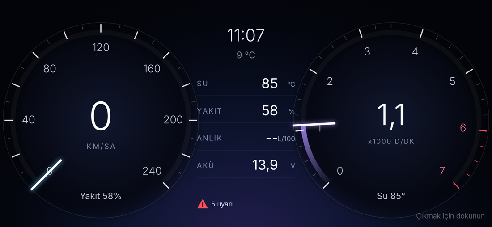
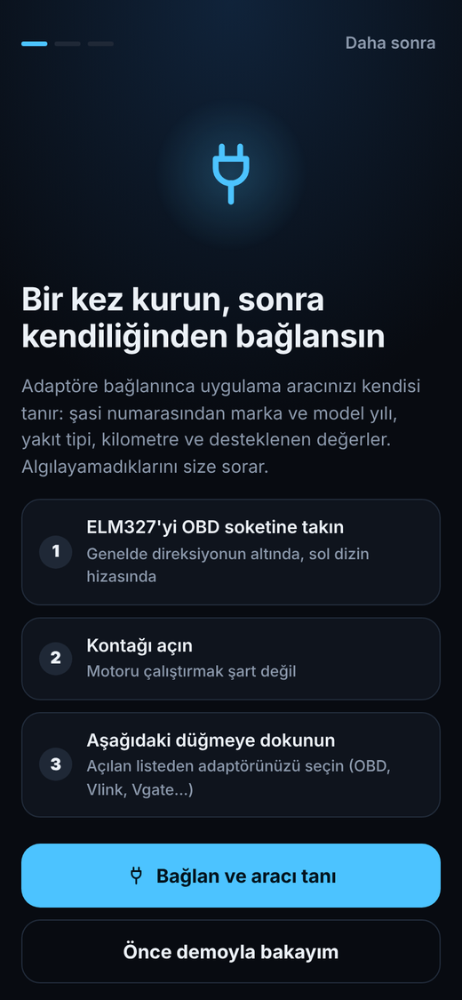
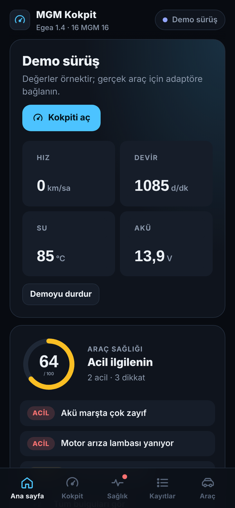
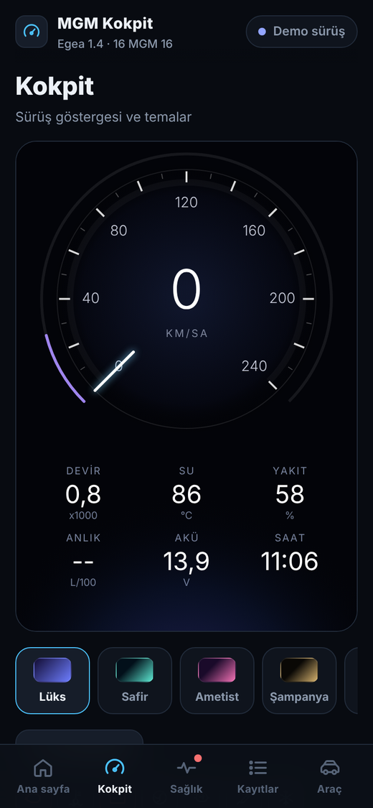
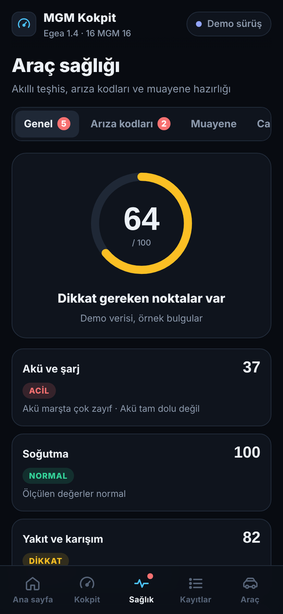
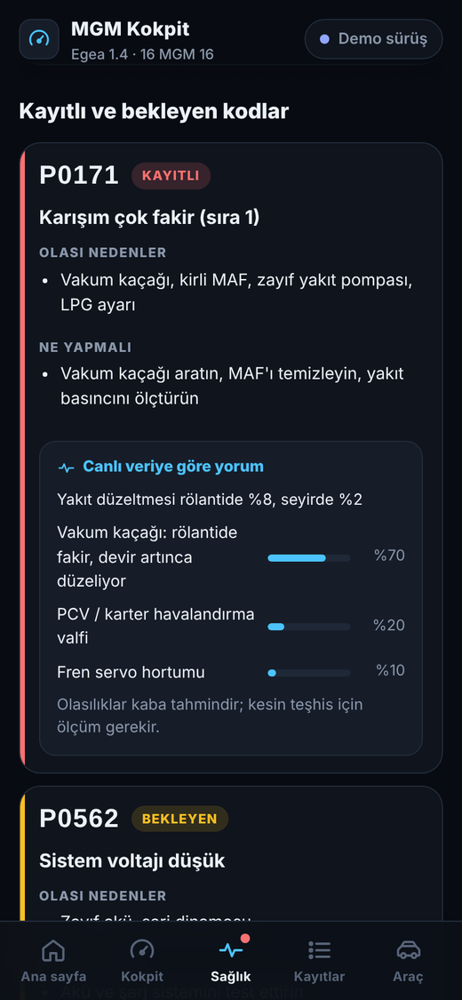
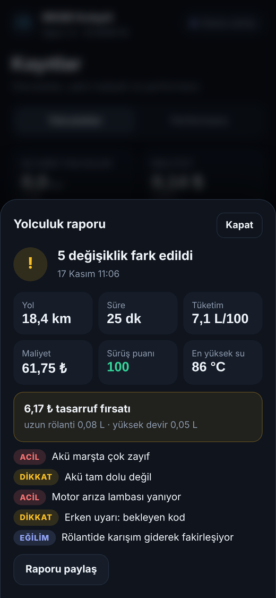
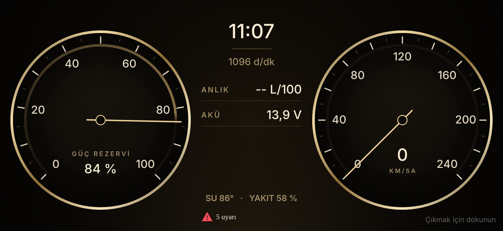
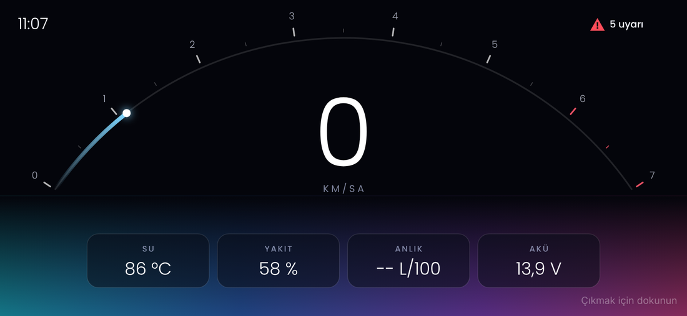
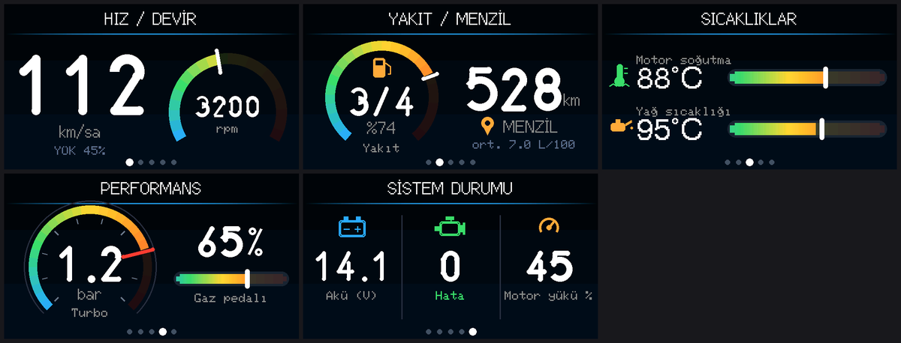

<div align="center">

# MGM Kokpit

**ELM327 ile sanal gösterge paneli ve akıllı arıza tespiti**
Telefonda çalışan web uygulaması + M5StickC Plus için sürüş asistanı yazılımı

[](https://mertguzelmansur.github.io/MGM-COCKPIT/)


</div>

<p align="center">
  
</p>

## İçindekiler

| Bölüm | Ne | Nerede |
|---|---|---|
| **Mobil uygulama** | Telefonda sanal kokpit, akıllı teşhis, yolculuk ve bakım kayıtları. Ek donanım yok, sadece ELM327. | [`index.html`](index.html) · [canlı sürüm](https://mertguzelmansur.github.io/MGM-COCKPIT/) |
| **M5Stick yazılımı** | M5StickC Plus / Plus2 için Bluetooth ses kumandası + OBD2 sürüş asistanı + robot gözler. | [`m5stick/`](m5stick/) |

> **Not:** BLE ELM327 adaptörü aynı anda tek cihaza bağlanır. Telefon uygulaması ile M5Stick'i aynı adaptörle birlikte kullanacaksanız birini kapatın (M5Stick'te Menü > OBD2 sürüş asistanı > "Sürüş asistanı: Kapalı" yeterli).

---

## 📱 Mobil uygulama

Tek bir HTML dosyası. Kurulum, hesap ya da sunucu yok; tüm veriler telefonun kendi tarayıcı hafızasında kalır.

<p align="center">
  
  
  
  
</p>

### Özellikler

**Bağlantı ve kurulum**
- Bir kez kurulum: araç şasi numarasından (VIN) marka ve model yılı, yakıt tipi, kilometre ve desteklenen değerler otomatik okunur; okunamayanlar birkaç soruyla tamamlanır
- Açılışta tek dokunuşla (tarayıcı izin veriyorsa dokunmadan) kayıtlı adaptöre bağlanma
- Bağlantı koparsa 90 sn boyunca kendiliğinden yeniden bağlanma
- Birden fazla araç: her araç şasi numarasıyla ayrı profil, bakım defteri ve öğrenilen değerler

**Kokpit**
- 18 tema; bunların 9'u "Lüks serisi": Lüks, Safir, Ametist, Şampanya, Zümrüt, Yıldız, İnci, Platin, Ufuk
- Yatay tam ekran ve dikey yerleşim, HUD (ön cama yansıtma) ayna modu, otomatik gece teması
- Gösterge alanları seçilebilir (su, yakıt, anlık tüketim, akü, turbo...)

**Akıllı teşhis**
- 8 sistemde kural tabanlı arıza tespiti: akü ve şarj, soğutma, karışım, ateşleme, hava/turbo, egzoz/katalizör/DPF, arıza kodları, bakım
- **Kişisel normal:** ilk 5 yolculukta aracın normali öğrenilir, sonraki değişimler arıza lambası yanmadan fark edilir
- **Kod + canlı veri yorumu:** her arıza kodu için canlı veriye göre olasılık sıralı nedenler
- Silindir bazında tekleme sayaçları (Mode 06, CAN araçlar)
- Akü ömrü tahmini, akü sağlığı, araç dururken kaçak akım tespiti
- Hararet erken uyarısı (sıcaklık artış hızına göre)
- Arıza kodu okuma/silme, arıza anı verisi (freeze frame), muayene hazırlık testleri

**Kayıtlar**
- Yolculuk geçmişi, aylık maliyet grafiği, CSV dışa aktarma
- Yolculuk sonu raporu: tüketim, maliyet, sürüş puanı, TL olarak tasarruf fırsatı, yeni bulgular
- Yakıt alımını otomatik algılama; pompadaki litreyle tüketim hesabının araca göre kalibrasyonu
- Kullanıma göre bakım aralığı (kısa yol / rölanti oranı yüksekse yağ aralığı kısalır)
- 0–100, 400 m ve 100–0 fren ölçümü; GPS ile hız göstergesi sapması
- Sürüş koçu ipuçları (ekranda ve isteğe bağlı sesli)

<p align="center">
  
  
</p>

<p align="center">
  
  
</p>

### Kullanım

**iPhone:** Safari Web Bluetooth desteklemez. App Store'dan ücretsiz **Bluefy** tarayıcısını kurun ve şu adresi açın:
```
https://mertguzelmansur.github.io/MGM-COCKPIT/
```
**Android:** Chrome ile aynı adresi açın.

1. ELM327 **BLE** (Bluetooth 4.0) adaptörünü OBD soketine takın, kontağı açın
2. "Bağlan ve aracı tanı"ya dokunun, listeden adaptörü seçin (OBD, Vlink, Vgate...)
3. Eksik birkaç soruyu yanıtlayın; kokpit açılır

Adaptörünüz yoksa **Demo sürüş** ile tüm ekranları deneyebilirsiniz.

> Klasik Bluetooth (SPP) ELM327'ler iPhone'da çalışmaz; BLE sürümü gerekir.

---

## ⌚ M5Stick yazılımı

`M5StickCPlus_BT_Volume` — sürüm **5.8.1-M5**. Ayrıntılar: [`m5stick/README.md`](m5stick/README.md)

<p align="center">
  
</p>

- Bluetooth (BLE HID) ses kumandası: telefon / tablet / PC ses ayarı, medya tuşları
- OBD2 sürüş asistanı (BLE ELM327): kokpit temaları, grafik, yolculuk geçmişi, araç sağlığı ve erken uyarılar
- Animasyonlu robot gözler, iPhone'dan saat, çalan şarkı ve hava durumu
- IR TV kumanda, karaoke modu, I2C enkoder ünitesi desteği

---

## Klasör yapısı

```
MGM-COCKPIT/
├── index.html                  Mobil uygulama (GitHub Pages bu dosyayı yayınlar)
├── m5stick/
│   ├── README.md               Derleme ve kullanım
│   ├── LICENSE                 GPL-3.0
│   └── M5StickCPlus_BT_Volume/ Arduino projesi (.ino + gerekli dosyalar)
└── docs/img/                   Ekran görüntüleri
```

## Uyarı

Bu proje kişisel/eğitim amaçlıdır. Teşhis sonuçları tahmindir ve servis ölçümünün yerini tutmaz. Sürüş sırasında ekranla uğraşmayın; telefonu sabit bir tutucuya yerleştirin.

## Lisans

- Mobil uygulama: [MIT](LICENSE)
- M5Stick yazılımı: [GPL-3.0](m5stick/LICENSE) (içindeki IR kod veritabanı GPL-3.0 kaynaklı veri içerdiği için)

---

<div align="center">
Mert Güzelmansur · MGM
</div>
