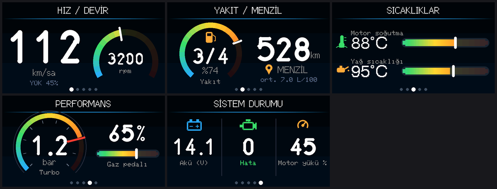
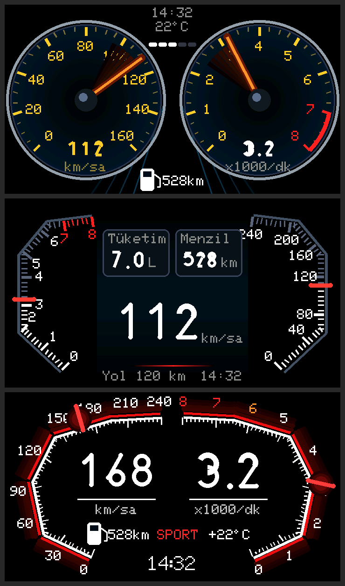
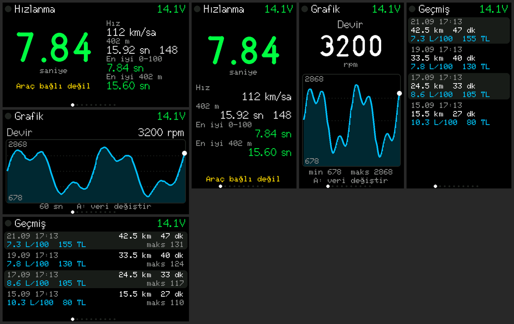
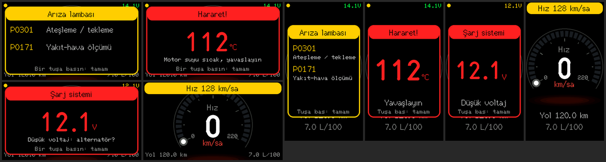
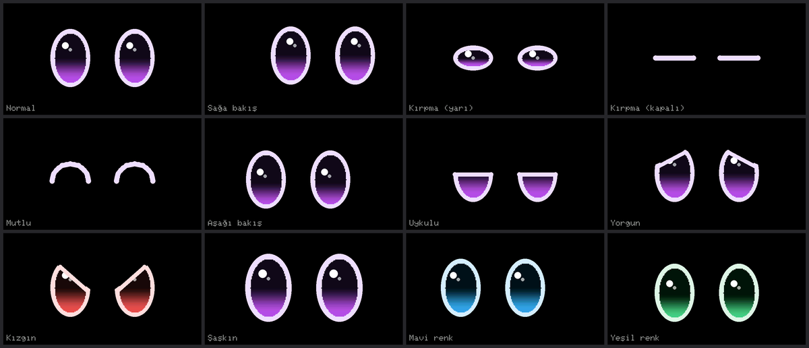
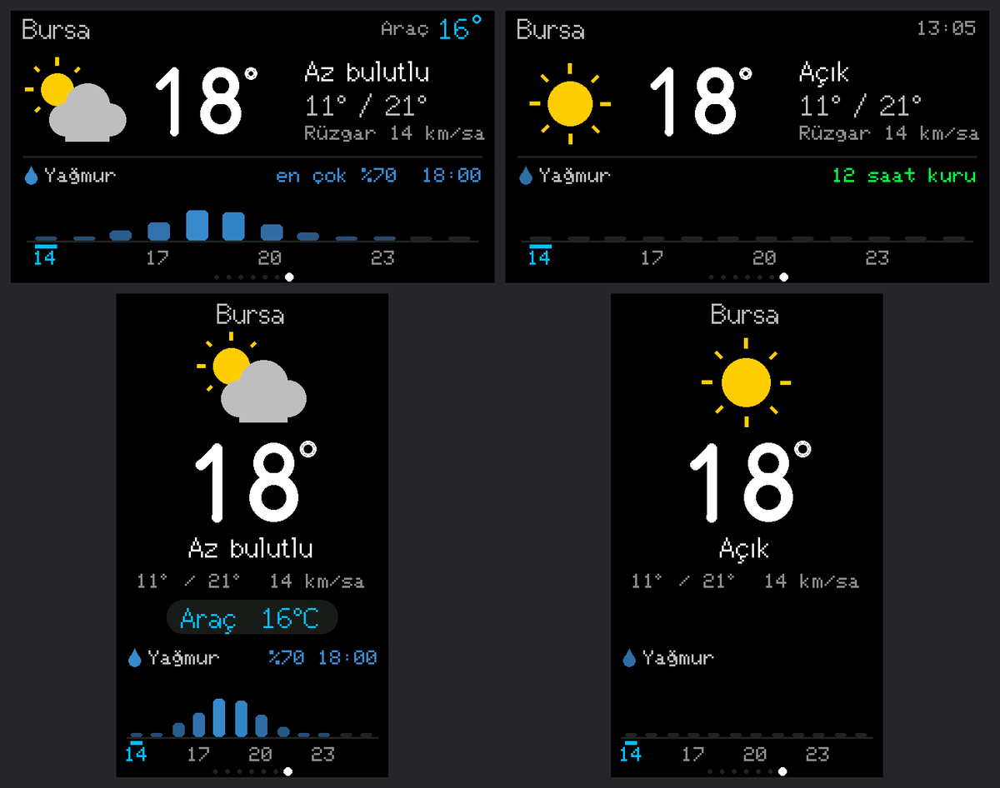

# MGM BT Volume — M5StickC Plus / Plus2

Bluetooth ses kumandası + OBD2 sürüş asistanı + animasyonlu robot gözler.
Sürüm: **5.8.1-M5**

<p align="center">
  
</p>

## Özellikler

| | |
|---|---|
| **Ses kumandası** | BLE HID medya tuşu cihazı: telefon / tablet / PC ile eşleşir, ses +/-, sessiz, oynat/duraklat, sonraki/önceki şarkı. iPhone'da çalan şarkı ve ses seviyesi ekranda (AMS). |
| **OBD2 sürüş asistanı** | BLE ELM327 adaptörü ile kokpit temaları, tek veri / çoklu veri sayfaları, canlı grafik, 0–100 ve 402 m ölçer, yolculuk geçmişi (TL maliyet). Ses kumandasıyla aynı anda çalışır. |
| **Araç sağlığı** | Marş anı akü voltajı geçmişi, ısınma/termostat, öğrenilen normal motor sıcaklığına göre hararet eğilimi, uzun dönem yakıt ayarı, rölanti dalgalanması, bakım km. Arıza lambası/kodları, hararet, şarj, hız ve vites uyarıları her ekranın üstünde. |
| **Robot gözler** | Halka göz ve modern göz stilleri; hareket sensörüyle eğim/viraj takibi, sarsıntıda şaşırma, 3 kez sallayınca parçacıklara dağılma. Mikrofonla alkış/ritim tepkisi. Bağlantı yokken uyur. |
| **Saat ve hava** | Saat iPhone'dan (BLE Current Time) + BM8563 donanım saati. Hava durumu iPhone Kestirmeler bildirimiyle (`MGMWX`), 12 saatlik yağmur grafiği ve hava uyarıları. |
| **IR TV kumanda** | ~290 TV güç kodu, 26 marka grubu, kendi kumandanı öğretme (IR alıcı G26). |
| **Karaoke** | Mikrofon → Bluetooth hoparlör, eko efekti. |
| **Enkoder** | I2C enkoder ünitesi (Grove 0x40: M5 Unit Encoder veya MGM_Encoder_C3 kutusu). |

<p align="center">
  
  
</p>
<p align="center">
  
</p>
<p align="center">
  
  
</p>

## Derleme (Arduino IDE)

Ek kütüphane gerekmez; ekran sürücüsü (TFT_eSPI) proje klasöründe `src/` altında, M5 için ayarlı kopya olarak durur. Arduino'daki kendi TFT_eSPI kurulumunuza dokunmaz.

1. Arduino IDE'ye **esp32** kart paketini kurun (Espressif). Test edilen sürüm **3.2.0** (2.0.17 de çalışır).
2. `M5StickCPlus_BT_Volume/M5StickCPlus_BT_Volume.ino` dosyasını açın.
3. Araçlar menüsü:

   | Ayar | Core 3.x | Core 2.0.17 |
   |---|---|---|
   | Kart | `M5StickCPlus` veya `M5StickCPlus2` | `M5Stick-C` |
   | Partition Scheme | `Huge APP (3MB No OTA/1MB SPIFFS)` | `No OTA (Large APP)` |
   | PSRAM | `Disabled` | `Disabled` |

4. Core 2.0.17 kullanıyorsanız `board_config.h` içinde `M5_BOARD_MANUAL` değerini kartınıza göre ayarlayın: arkasında sadece **PLUS** yazıyorsa `1`, **PLUS2** yazıyorsa `2`. Core 3.x'te kart menüden otomatik algılanır.
5. Yükleyin.

## İlk kullanım

- **Telefon eşleşmesi:** Telefonun Bluetooth ayarlarında cihazı seçin. Eşleşme varsayılan olarak onaysızdır; isterseniz Ayarlar > "Eşleşme onayı" ile kartta 6 haneli kod onayı açılır.
- **OBD2:** Menü > "OBD2 sürüş asistanı" içinde "Sürüş asistanı"nı açın ve "Adaptör seç" ile BLE ELM327'yi bir kez seçin. Yakıt tipi, motor hacmi, depo hacmi, uyarı eşikleri ve bakım aralığı da buradan ayarlanır. Adaptör bağlanınca ana ekran OBD2 arayüzlerine geçer, kopunca gözlere döner.
- **Hava durumu:** iPhone Kestirmeler uygulamasında `MGMWX;T=..;C=..` biçiminde bildirim gönderen bir kestirme kurun. Seri porttan test için (115200 baud):
  ```
  MGMWX;T=18;C=Yagmurlu;W=14;L=11;H=21;S=14
  MGMTIME=<epoch UTC>
  ```

## Tuşlar

| Ekran | Tuş | İşlev |
|---|---|---|
| Ses (bağlı) | A (ön, M5) | Ses + (basılı tut = hızlı) · çift tık: sonraki şarkı |
| | B (yan) | Ses − · çift tık: önceki şarkı |
| | GÜÇ (sol yan) | Kısa: menü / geri · 6 sn: kapat |
| | A + B kısa | Oynat / duraklat |
| | A + B 3 sn | Menü |
| OBD2 ana ekran | A kısa | Sonraki sayfa |
| | A çift tık | Sayfa işlemi (ölçümü başlat vb.) |
| | B kısa | Önceki sayfa |
| | A / B basılı | Ses + / − |
| Menü | B · A · A uzun | Sonraki · seç · geri |
| Enkoder | Çevir · kısa · çift · uzun | Ses / menüde gezin · sonraki OBD sayfası · oynat/durdur · menü/geri |

## Bilinen sınırlar

- BLE ELM327 aynı anda tek cihaza bağlanır: telefondaki **MGM Kokpit** uygulamasıyla aynı adaptörü kullanacaksanız M5Stick'te "Sürüş asistanı"nı kapatın.
- Klasik Bluetooth (SPP) ELM327 adaptörleri desteklenmez, BLE sürümü gerekir.
- Wi-Fi v5.1'de kaldırıldı (bellek için); saat ve hava telefondan gelir.

## Lisans ve kaynaklar

Bu klasör **GPL-3.0** ile lisanslıdır ([LICENSE](LICENSE)).

- `src/TFT_eSPI/` — Bodmer'ın TFT_eSPI kütüphanesinin projeye özel kopyası, kendi lisansıyla (`src/TFT_eSPI/license.txt`)
- `ir_db.h` — [Flipper-IRDB](https://github.com/Lucaslhm/Flipper-IRDB) (CC0 1.0) ve Flipper Zero evrensel TV listesi (GPL-3.0) kaynaklı IR kodları
